# Lab 3 — Teardown, and the same machine from the command line

Pair:  Diana Osmushko                   Driver first half: Diana Osmushko
Machine: Windows Laptop
Date: 05.11.2026 - 08.11.2026

## What I did

### Part 1: Component Teardown & Research

1. Researched the 10 components from the makers' websites, identified interfaces and limits:
   * **AMD Ryzen 5 7600**: Desktop CPU (6 cores / 12 threads), AM5 socket (LGA 1718). Limits: Only DDR5 memory supported, requires AM5 motherboard. Includes AMD Wraith Stealth cooler. [AMD Product Page](https://www.amd.com/en/products/processors/desktops/ryzen/7000-series/amd-ryzen-5-7600.html)
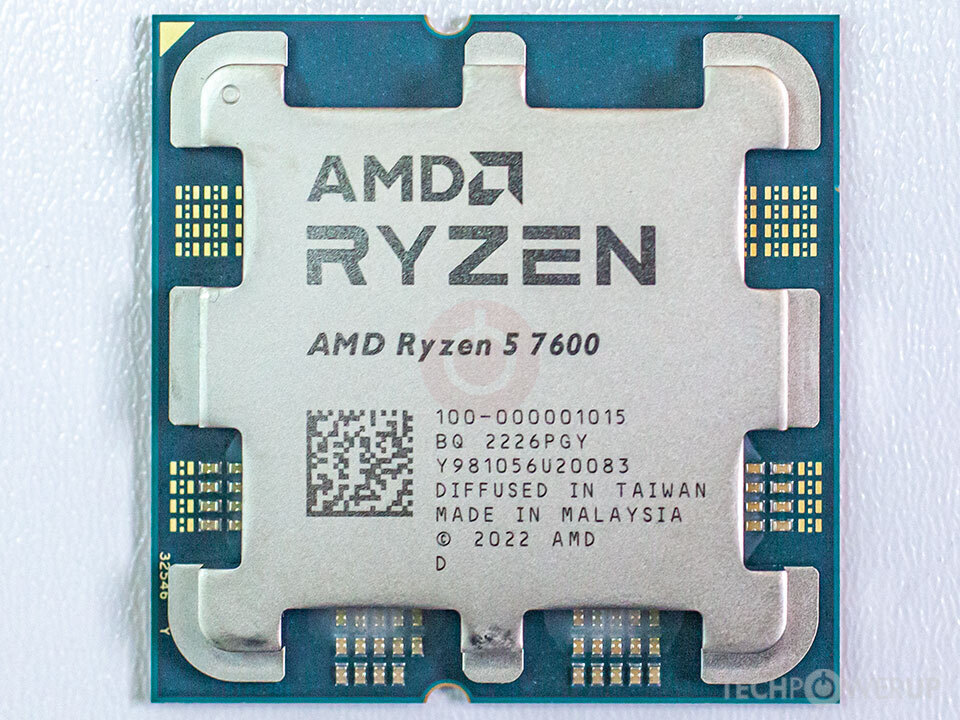
   * **Intel Core i5-13400**: Desktop CPU (10 cores / 16 threads), LGA 1700 socket. Limits: Compatible with Intel 600/700 series chipsets only. Includes Intel Laminar RM1 cooler. [Intel Product Page](https://www.intel.com/content/www/us/en/products/sku/230495/intel-core-i513400-processor-20m-cache-up-to-4-60-ghz/specifications.html)
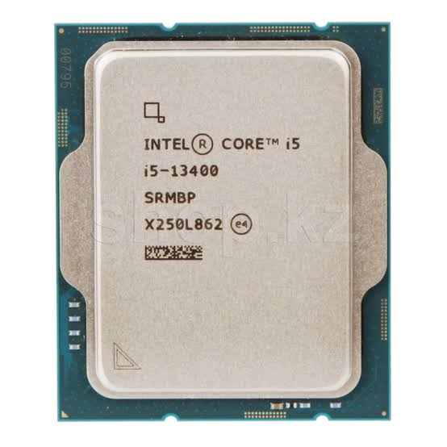
   * **ASUS PRIME B650M-A**: Micro-ATX motherboard, AMD B650 chipset, Socket AM5. Limits: Only supports AM5 processors (Ryzen 7000/8000/9000) and DDR5 DIMM. [ASUS Product Page](https://www.asus.com/motherboards-components/motherboards/prime/prime-b650m-a/)
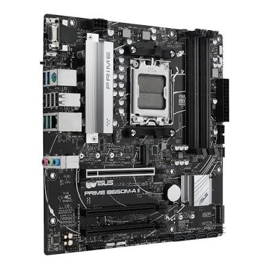
   * **MSI PRO B760M-A WIFI DDR4**: Micro-ATX motherboard, Intel B760 chipset, Socket LGA 1700. Limits: Supports Intel 12th/13th/14th Gen CPUs and DDR4 memory only (not DDR5). [MSI Product Page](https://www.msi.com/Motherboard/PRO-B760M-A-WIFI-DDR4)
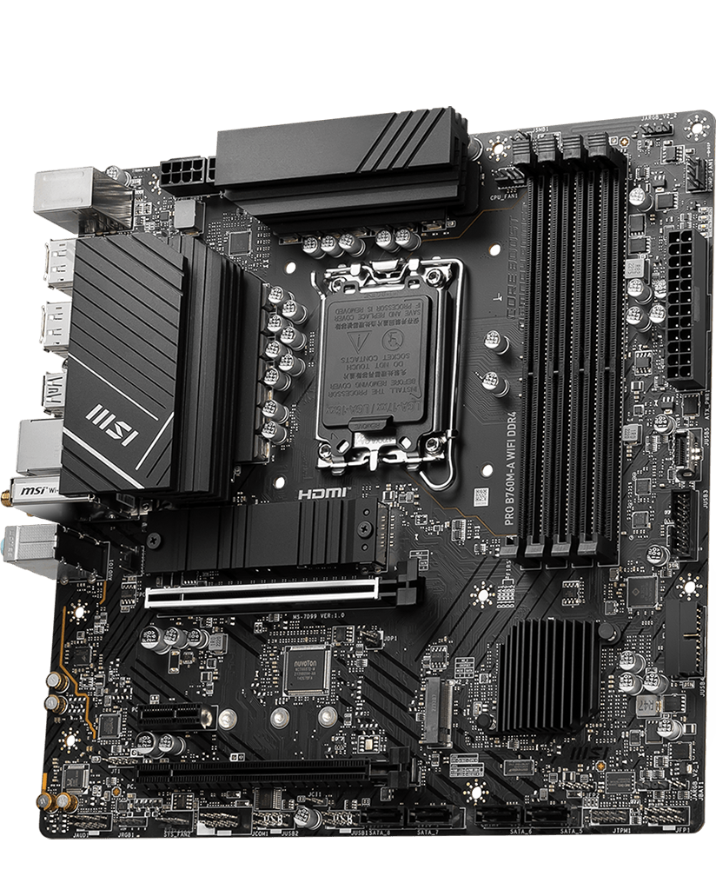
   * **Kingston FURY Beast DDR5-5600 16 GB**: 288-pin DDR5 UDIMM module. Limits: Fits only DDR5 slots, keyed differently from DDR4. [Kingston Product Page](https://www.kingston.com/en/memory/gaming/kingston-fury-beast-ddr5-memory)
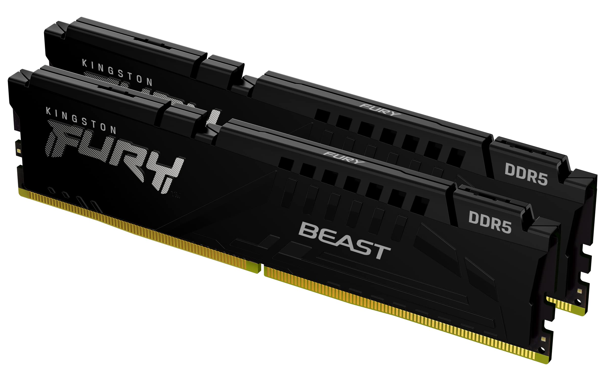
   * **Crucial DDR4-3200 16 GB DIMM**: 288-pin DDR4 UDIMM module. Limits: Fits only DDR4 slots, capped at DDR4-3200 speeds. [Crucial Product Page](https://www.crucial.com/memory/ddr4/ct16g4dfra32a)
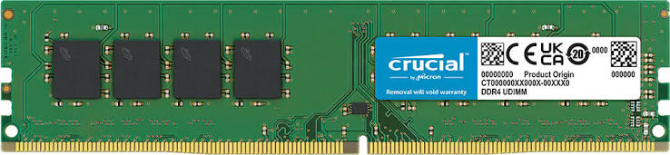
   * **Samsung 990 PRO 1 TB**: M.2 2280 NVMe SSD (PCIe 4.0 x4). Limits: Requires M.2 Key-M PCIe slot for full bandwidth. [Samsung Product Page](https://semiconductor.samsung.com/consumer-storage/internal-ssd/990-pro/)
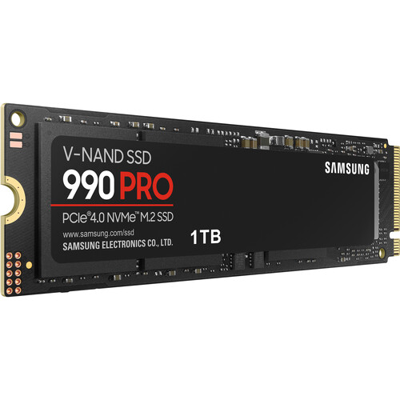
   * **Samsung 870 EVO 1 TB**: 2.5-inch SATA III SSD. Limits: Interface limit of 6 Gbps (~560 MB/s), requires SATA data and power cables. [Samsung Product Page](https://semiconductor.samsung.com/consumer-storage/internal-ssd/870-evo/)
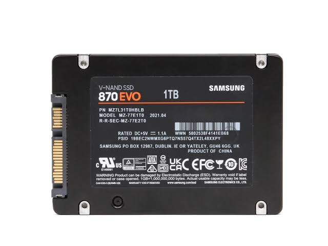
   * **Corsair RM750e (750 W)**: Fully modular ATX power supply, 80 PLUS Gold. Limits: Max 750 W load, standard ATX case mount required. [Corsair Product Page](https://www.corsair.com/us/en/p/psu/cp-9020262-na/rme-series-rm750e-fully-modular-low-noise-atx-power-supply-cp-9020262-na)
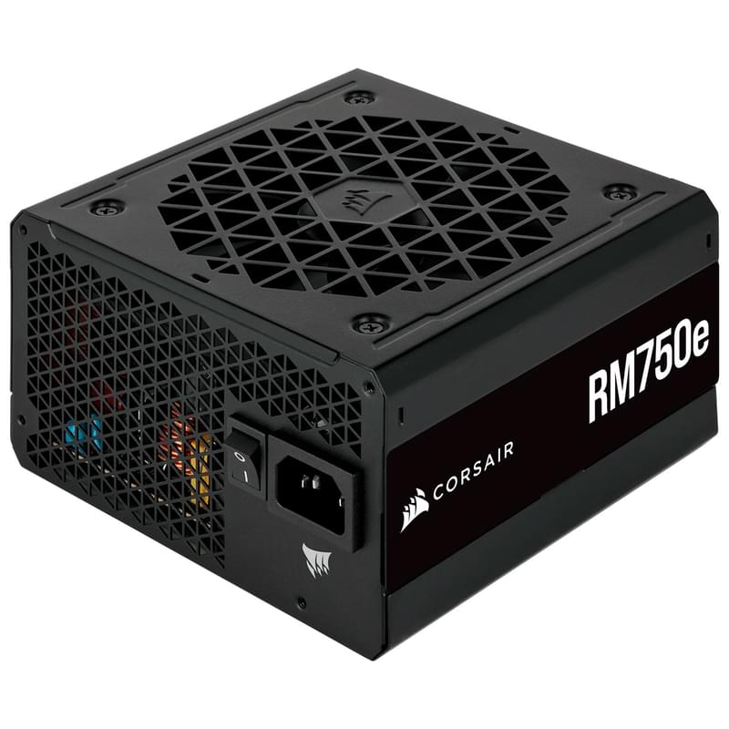
   * **Stock Coolers (AMD Wraith Stealth / Intel Laminar RM1)**: CPU air coolers bundled in processor boxes. Limits: Wraith Stealth fits AM4/AM5 only; Laminar RM1 fits LGA 1700 only; both designed for 65W TDP.[AMD Wraith Stealth Page](https://www.amd.com/en/products/processors/ecosystem/cpu-cooler-solutions.html), [Intel Laminar RM1 Page](https://www.intel.com/content/www/us/en/support/articles/000089190/processors/intel-core-processors.html)
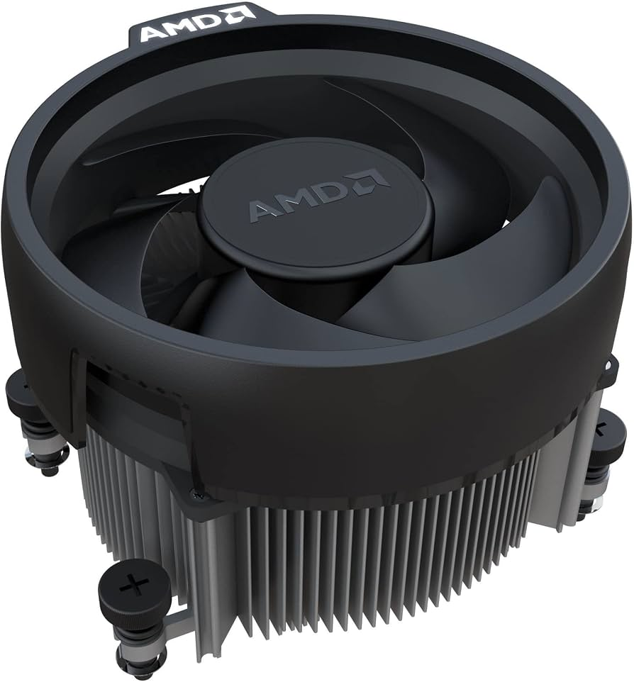
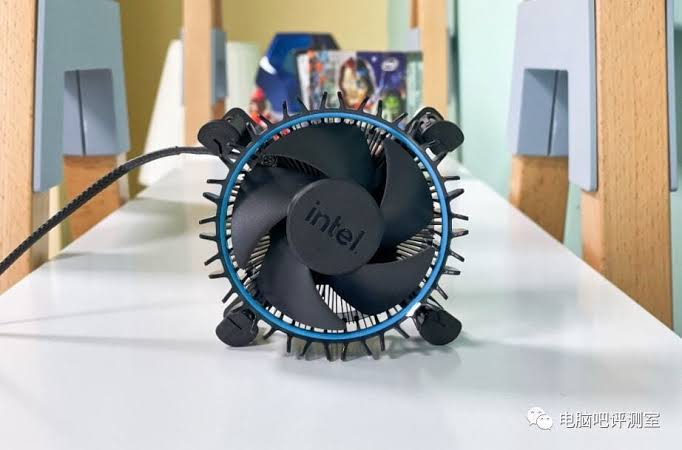
2. Planned two compatible builds:
   * **Build 1 (AMD AM5 + DDR5)**:
     - CPU: AMD Ryzen 5 7600
     - Motherboard: ASUS PRIME B650M-A (Socket AM5, B650 chipset)
     - RAM: Kingston FURY Beast DDR5-5600 16 GB
     - Storage: Samsung 990 PRO 1 TB (M.2 NVMe)
     - Cooler: Stock AMD Wraith Stealth cooler (shipped with CPU)
     - PSU: Corsair RM750e (750 W)
     - Justification: Ryzen 5 7600 fits AM5 socket; ASUS B650 board requires DDR5 which matches Kingston DDR5 RAM; M.2 slot supports NVMe Gen4 speeds.
     - Still needed: Micro-ATX/ATX case, peripherals (monitor, keyboard, mouse).
   * **Build 2 (Intel LGA 1700 + DDR4)**:
     - CPU: Intel Core i5-13400
     - Motherboard: MSI PRO B760M-A WIFI DDR4 (Socket LGA 1700, B760 chipset)
     - RAM: Crucial DDR4-3200 16 GB DIMM
     - Storage: Samsung 870 EVO 1 TB (2.5" SATA)
     - Cooler: Stock Intel Laminar RM1 cooler (shipped with CPU)
     - PSU: Corsair RM750e (750 W)
     - Justification: Core i5-13400 fits LGA 1700 socket; motherboard explicitly supports DDR4 matching Crucial RAM; SATA SSD connects via SATA 6Gb/s port.
     - Still needed: Second PSU (if running concurrently), SATA data cable, case, peripherals.

---

### Part 2: Hardware Inspection via Command Line
CPU, memory, and disk specifications from the OS command line using modern PowerShell CIM cmdlets on the host and terminal commands in the Linux guest VM.

1. Extracted CPU details on Windows (PowerShell):
```powershell
Get-CimInstance Win32_Processor | Select-Object Name, NumberOfCores, NumberOfLogicalProcessors
```
Output:
```text
Name                                    NumberOfCores NumberOfLogicalProcessors
----                                    ------------- -------------------------
Intel(R) Pentium(R) CPU 5405U @ 2.30GHz             2                         4
```

2. Extracted Memory details on Windows (PowerShell):
```powershell
Get-CimInstance Win32_PhysicalMemory | Select-Object Capacity, Speed, SMBIOSMemoryType
```
Output:
```text
  Capacity Speed SMBIOSMemoryType
  -------- ----- ----------------
4294967296  2133               26
```

3. Extracted Disk details on Windows (PowerShell):
```powershell
Get-CimInstance Win32_DiskDrive | Select-Object Model, Size, MediaType
```
Output:
```text
Model                   Size MediaType
-----                   ---- ---------
RPFTJ256PDD2MWX 256052966400 Fixed hard disk media
```

4. Extracted CPU and Disk info on Linux (VM):
```bash
lscpu | grep -E "Model name|CPU\(s\):"
lsblk -d -o NAME,MODEL,SIZE,TRAN
```
Output:
```text
CPU(s):                                  1
Model name:                              Intel(R) Pentium(R) CPU 5405U @ 2.30GHz
NAME  MODEL          SIZE TRAN
sda   VBOX HARDDISK   25G sata
```

## Result
### Command Comparison Across Operating Systems

| Specification / Hardware Fact | Windows Command (PowerShell) | Linux Command (Terminal) |
| :--- | :--- | :--- |
| **CPU Model Name** | `Get-CimInstance Win32_Processor \| Select-Object Name` | `lscpu \| grep "Model name:"` |
| **CPU Cores & Threads** | `Get-CimInstance Win32_Processor \| Select-Object NumberOfCores, NumberOfLogicalProcessors` | `lscpu \| grep -E "^CPU\(s\):\|Core\(s\) per socket:"` |
| **Total System RAM** | `(Get-CimInstance Win32_ComputerSystem).TotalPhysicalMemory` | `free -h` |
| **RAM Module Details** | `Get-CimInstance Win32_PhysicalMemory \| Select-Object Capacity, Speed, SMBIOSMemoryType` | `sudo dmidecode --type memory \| grep -E "Size\|Type\|Speed"` |
| **Storage Drive Model & Size** | `Get-CimInstance Win32_DiskDrive \| Select-Object Model, Size, MediaType` | `lsblk -d -o NAME,MODEL,SIZE,TRAN` |
| **Filesystem / Disk Usage** | `Get-CimInstance Win32_LogicalDisk \| Select-Object DeviceID, FreeSpace, Size` | `df -h` |


## What did not work the first time
* **What I saw:** When trying to execute `wmic` commands in Windows 11 PowerShell, the system threw a `CommandNotFoundException` error stating that 'wmic' is not recognized as a cmdlet or operable program.
* **What it turned out to be:** Microsoft has deprecated and completely removed the WMIC tool from modern Windows 11 builds
* **What I did about it:** I pivoted to modern PowerShell infrastructure and utilized `Get-CimInstance` cmdlets (`Win32_Processor`, `Win32_PhysicalMemory`, and `Win32_DiskDrive`) to successfully pull the hardware specs.

## Evidence
- [evidence/photos/](evidence/photos/) — Contains manufacturer product images for all 10 researched hardware components.
- [evidence/windows-specs.txt](evidence/windows-specs.txt) — Raw PowerShell command-line output showing the authentic Intel Pentium 5405U host CPU, single 4 GB DDR4 RAM stick (2133 MT/s), and the 256 GB host storage drive.
- [evidence/linux-specs-vm.txt](evidence/linux-specs-vm.txt) — Raw command-line output from the VirtualBox Linux guest VM, verifying its 1 allocated virtual CPU core and 25 GB virtual SATA drive.
